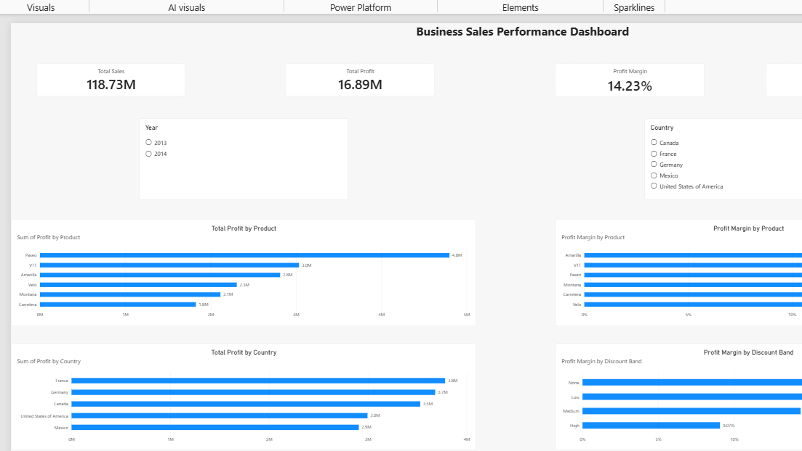

Business Sales Performance Analysis
An independent Excel and Power BI portfolio project analyzing Microsoft's Financial Sample dataset. This is sample data, not real company financial reporting.
Dashboard

Business question
Which products, countries, and discount bands are associated with stronger profitability?
Tools and approach
Excel: checked data types and duplicates, created PivotTables, and compared sales, profit, and margin.
Power BI: built four KPI cards, five charts, DAX profit margin measure, and Year/Country slicers.
DAX: `Profit Margin = DIVIDE(SUM('financials (2)'[Profit]), SUM('financials (2)'[ Sales]))` (field names are as used in the local report).
Headline results
KPI	Value
Sales	$118.73M
Profit	$16.89M
Profit margin	14.23%
Units sold	1.13M
Insights
Paseo generated the most profit (~$4.80M), while Amarilla had the highest product profit margin (15.86%).
France generated the most country profit (~$3.78M), while Germany had the highest country margin (15.66%).
Profit margin by discount band: None 21.86%, Low 17.87%, Medium 14.39%, High 9.07%. This is an association, not proof of causality.
The sample includes only part of 2013; do not treat 2013 vs 2014 annual totals as a comparable full-year growth rate.
Recommendations
Examine discount profitability by product and segment before changing promotional strategy.
Evaluate products using both absolute profit and profit margin.
Investigate market differences in cost structure, product mix, and discounts.
Validate trends using comparable time periods and additional data.
Files
`dashboard_screenshot.png` — screenshot of the finished dashboard.
`Business_Sales_Performance_Case_Study.pdf` — written case study.
To add: `Business_Sales_Performance_Dashboard.pbix` — export/copy from Power BI Desktop on your computer.
Dataset
Microsoft Power BI Financial Sample.
Notes
This project demonstrates exploratory/descriptive analysis, not causal inference or production forecasting. No private employer data was used.
